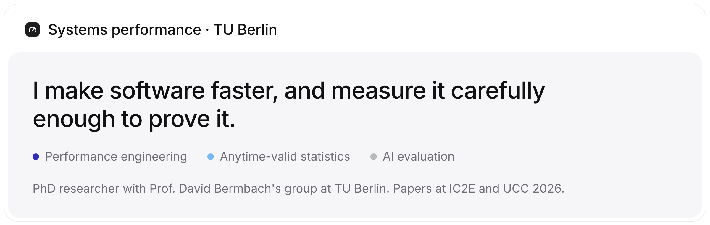
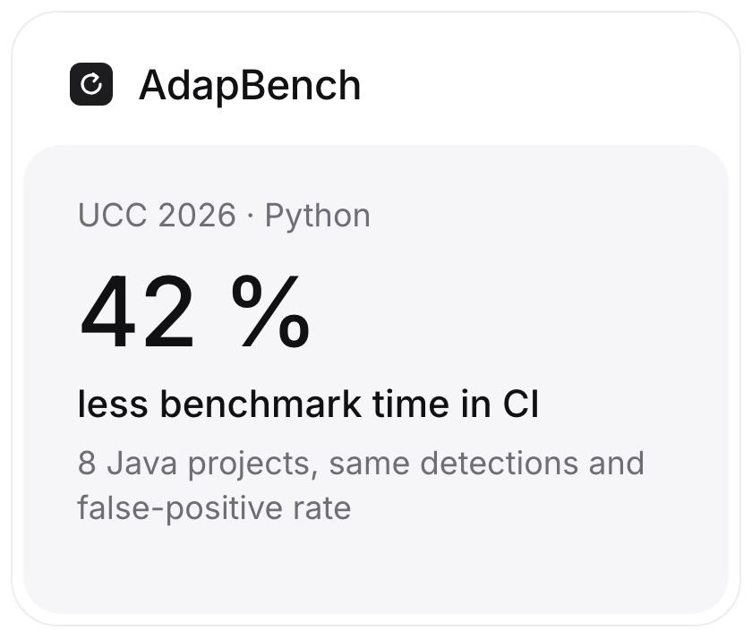
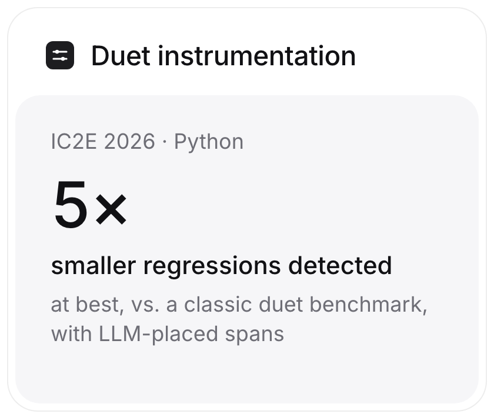
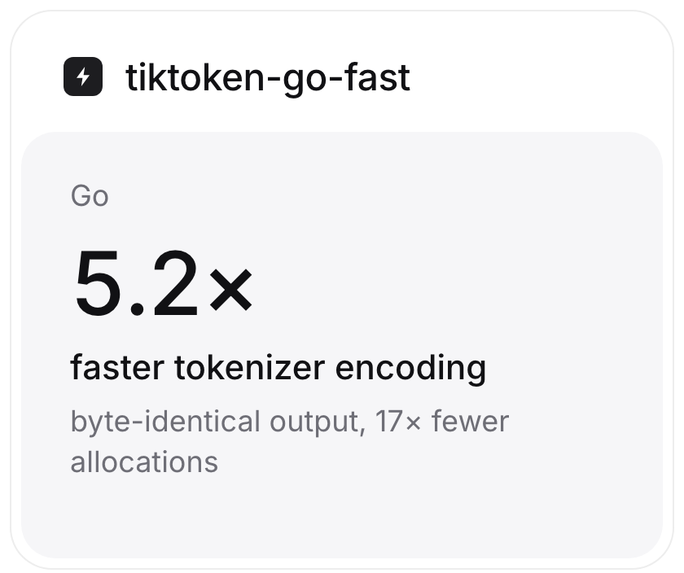

<picture><source media="(prefers-color-scheme: dark)" srcset="assets/hero-dark.png"></picture>

<a href="https://github.com/s3bastiankoch/adapbench"><picture><source media="(prefers-color-scheme: dark)" srcset="assets/tile-adapbench-dark.png"></picture></a>
<a href="https://github.com/s3bastiankoch/duet-instrumentation"><picture><source media="(prefers-color-scheme: dark)" srcset="assets/tile-duet-dark.png"></picture></a>
<a href="https://github.com/s3bastiankoch/tiktoken-go-fast"><picture><source media="(prefers-color-scheme: dark)" srcset="assets/tile-tiktoken-dark.png"></picture></a>

### Papers

- **Duet instrumentation.** S. Koch, N. Japke, D. Bermbach. *IC2E 2026.* [arXiv:2605.18397](https://arxiv.org/abs/2605.18397) · [code](https://github.com/s3bastiankoch/duet-instrumentation)
- **AdapBench: adaptive early-stopping and prioritization for microbenchmark suites in CI/CD.** *UCC 2026.* [code and data](https://github.com/s3bastiankoch/adapbench)

### Also

[gxpeval](https://github.com/s3bastiankoch/gxpeval) validates LLM use in GxP-regulated work with anytime-valid tests.

[sbstn.io](https://sbstn.io)
